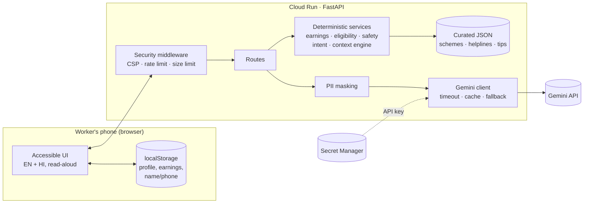

# Saathi — Gig Worker Companion

A multilingual, GenAI-powered assistant for India's gig and informal workers — delivery partners, cab and bike-taxi drivers, daily-wage, construction and domestic workers. Saathi ("companion") helps them **track real earnings, stay safe, find government schemes and rights, understand documents, and draft complaints** — in simple language, in their own language.

> **Chosen vertical:** Gig Worker Companion — PromptWars main challenge
>
> **In one line:** a smart, dynamic assistant that reads each worker's context (work type, shift, local time, logged earnings, weekly goal, scheme status) and decides — in transparent, tested code — what they should do next, then uses Gemini to explain it in their own language.

### What's new in this version

- **Weekly income-goal planner** — set a weekly take-home goal; Saathi computes hours needed at *your* current ₹/hour, the best weekdays and platform, and **refuses to push unsafe hours** (>12 h/day or >60 h/week), suggesting a realistic goal instead.
- **Explainable decisions** — every "Today for you" card carries a plain-language *"Why you see this"* reason.
- **Context-aware Ask** — questions are routed to up to **two** modules at once (e.g. a late payout *and* a blocked ID), and every answer is grounded in a snapshot of the worker's current priorities. The offline answer is built from the same facts, so Ask stays genuinely useful with no AI.
- **Stronger engineering** — `mypy` type checks, `pip-audit` dependency audit, browser-module unit tests (Node's built-in runner), `SECURITY.md`, CI split into backend and frontend jobs.

---

## The problem

Millions of gig and informal workers earn without payslips, face unexplained platform deductions and sudden ID blocks, work long hours on the road, and miss welfare schemes they qualify for — often because information is in English, scattered, or written in legal language. They need one simple tool, on a cheap phone, that understands their situation.

## What Saathi does

| Module | What the worker does | Decided by code (deterministic) | Gemini's role |
|---|---|---|---|
| **Today for you** (home) | Opens the app | A context engine ranks action cards from profile, local time, earnings and weekly goal — each with a "why you see this" reason | — |
| **Ask** | Types any question | Multi-intent router (English, Hindi, Hinglish) picks up to two modules; facts include the worker's current priorities; a useful offline answer is built from the same facts | Answers using only those facts |
| **Earnings** | Logs pay, hours, km, fuel, platform cuts | Net take-home, ₹/hour, ₹/km, cost shares, week-on-week pay drop, long-shift and deduction alerts | Explains the numbers simply, with one tip |
| **Weekly goal** | Sets a ₹ target in their profile | Progress, hours needed at their own rate, hours/day, best weekdays and platform; *achieved / on track / stretch / unsafe* with a realistic alternative | Folds the plan into its explanation |
| **Safety** | Picks conditions (heat, rain, fog…) | Tips chosen by work type × time of day × weather; one-tap emergency numbers | Answers free-form safety questions |
| **Schemes & rights** | Sees what they qualify for | Rules engine: age, income, state, work type, EPFO/ESIC, tax, bank account, e-Shram → *eligible / one step left / not for you* with reasons | Explains a scheme grounded on the curated record |
| **Documents** | Pastes text or snaps a photo | PII masking, image validation, scheme document checklists | Explains the notice/contract (multimodal) |
| **Complaint** | Describes the problem | Issue type → where to file + helplines; template fallback | Drafts a firm letter in their language **plus** an English copy |

### Connected workflows

Modules hand work to each other so the app behaves as one product, not six forms:

- An **earnings pay-drop alert** → opens the complaint form pre-filled as *incentive not paid*.
- A **high-deductions alert** → opens the complaint form pre-filled with the deducted amount.
- A **long-shift alert** → opens Safety.
- A scheme that needs **e-Shram first** → jumps to e-Shram and explains it.
- A **scheme card** → opens Documents with that scheme's checklist.
- An **Ask** answer → offers to open the right section.
- **Home cards** reorder themselves: a night-shift rider sees night safety first; a worker not on e-Shram sees the registration nudge; an unsafe weekly goal jumps near the top.
- A **weekly-goal card** → opens Earnings with the full plan.
- An **Ask** question touching two topics → offers buttons for both sections.

## How it works



**Design principle — code decides, Gemini explains.** Numbers, eligibility and routing are computed in plain, tested Python. Gemini receives those results as `<facts>` and turns them into simple guidance in the worker's language. This keeps money figures exact, prevents invented schemes, and makes behaviour testable.

**Graceful degradation.** If Gemini is not configured, times out (20 s) or errors, every feature returns a built-in English/Hindi answer and the UI shows a small banner. One failing API call never breaks a flow.

### Decision logic examples

- **Pay drop:** this week's net ₹/hour vs the previous 7 days; a fall of ≥25% raises a warning with a complaint action.
- **Deductions:** platform cuts above 20% of earnings are flagged; fuel and other costs above 35% get a cost tip.
- **Scheme status:** a rule failure (e.g. age 45 for PM-SYM's 18–40 window) ⇒ *not for you*, with the reason; a fixable gap (no bank account, not on e-Shram, age missing) ⇒ *one step left* with the next action.
- **Safety:** tips tied to an active situation (night, rain, heat…) score above general tips; night = 8 pm–6 am or a night-shift profile.
- **Home cards:** each rule adds a card with a priority (night safety 90, pay drop 85, unsafe goal 83, deductions 80, e-Shram 75 …) and a reason; the top five are shown.
- **Weekly goal** (`app/services/planner.py`): week = Monday–Sunday in the worker's local date. Rate = this week's net ₹/hour (falls back to history). `hours_needed = remaining ÷ rate`, spread over the days left (today counts only if not yet logged). Safe hours left = `min(days_left × 12, 60 − hours already worked)`. More than that ⇒ **unsafe** with `realistic_goal = earned + safe_hours × rate`; more than 10 h/day ⇒ **stretch**; otherwise **on track**.
- **Ask routing:** keyword scores per module; the top two non-zero modules are answered together. With no match, Saathi lists the worker's top priorities and their reasons.

### Use of Generative AI

- `google-genai` SDK, model set by `GEMINI_MODEL` (default `gemini-3.8-flash`, a current stable Flash model — fast and low cost).
- One system instruction sets persona, plain-language style, reply language, "not legal advice" and "call 112 if in danger" rules.
- Worker text is wrapped in `<worker_input>` and the model is told to treat it as data (prompt-injection defence); `<`/`>` in worker text are neutralised so it cannot close the tag.
- **Multimodal:** photos of documents are sent with the prompt for explanation.
- Identical text prompts are cached in memory (LRU, 1 h TTL) to save cost and latency; photos are never cached.

## Security

- **Secrets:** Gemini key only in an environment variable locally and **Secret Manager** in production; `.env` is git-ignored; `/api/health` reports only whether AI is enabled.
- **Privacy by design:** profile, earnings and the worker's name/phone/ID live in the browser only. The server is stateless and stores nothing. Complaint letters use `[YOUR NAME]`-style placeholders that the browser fills in locally — personal identifiers never reach the server or the AI.
- **PII masking** before every AI call: Aadhaar, PAN, phone, email, UPI IDs, card and bank account numbers are replaced with `[LABEL]` and the worker is told what was hidden.
- **Input validation:** Pydantic models with bounds on every field, `extra="forbid"`, known-state list, no future incident dates; validation errors never echo submitted values.
- **Uploads:** base64 decoded strictly, size-capped (4 MB), and checked by magic bytes (JPEG/PNG/WebP); the browser re-encodes photos, which also strips EXIF/GPS.
- **HTTP hardening:** strict Content-Security-Policy (no inline script or style, no third-party origins), `X-Frame-Options: DENY`, `nosniff`, `Referrer-Policy: no-referrer`, HSTS, `Cache-Control: no-store` on API responses, 8 MB request cap, per-IP rate limit (30 POST/min), server header removed.
- **XSS-safe rendering:** all dynamic text is inserted with `textContent`, never `innerHTML`.
- **Supply chain:** pinned dependencies, `pip-audit` in CI; typed code checked by `mypy`. See [SECURITY.md](SECURITY.md) for the threat model.
- **Client dates validated:** the phone's local date is accepted only within ±1 day of the server date.
- **Container:** slim image, pinned dependencies, runs as a non-root user; the runtime service account can read only its one secret.

## Efficiency

- Gemini Flash; AI is called only when it adds value (e.g. safety tips and scheme matching need no AI call).
- Knowledge base loaded once and cached; prompt cache for repeated questions.
- No frontend framework or build step; total repo well under 1 MB; GZip for responses over 1 KB.
- Photos resized on the phone to ≤1600 px JPEG before upload (less mobile data).
- Cloud Run scales to zero; `--max-instances 3` caps cost.

## Accessibility

- Mobile-first, thumb-reachable bottom navigation; 18 px base text, an **A+** larger-text toggle, 44–48 px touch targets.
- The weekly goal uses a native `<progress>` element with an accessible label, and its status is written in words, not shown by colour alone.
- Semantic landmarks, skip link, one `h1` per view with focus moved on navigation, labels on every control, `aria-live` regions for results, `aria-current` on the active tab.
- **Read aloud** on every answer using the browser's speech engine, in the answer's language — helpful for workers who find reading hard.
- WCAG AA contrast, status shown with text and symbols (not colour alone), visible focus rings, `prefers-reduced-motion` and forced-colours support.
- `lang` attributes on AI answers so screen readers pronounce Hindi/Tamil/etc. correctly.

## Testing

**117 automated tests** — 109 Python tests at **98% line coverage** plus 8 browser-module tests — with no network needed (Gemini is replaced by a fake client):

- **Planner:** every decision branch (no data, achieved, on track, stretch, unsafe via daily *and* weekly caps, week over), history-rate fallback, best days/platform, Hindi text, zero-hour safety.
- **Unit:** earnings maths and alerts, eligibility rules, multi-intent ranking, assistant offline answers, safety selection, intent routing, home-card ranking, PII masking, prompt construction and injection-delimiter safety, cache/timeout/fallback behaviour, rate limiter, image validation.
- **API:** every endpoint, offline fallbacks, Hindi output, validation (negative pay, 30-hour days, unknown fields, unknown state, future dates, path-like IDs), 413 oversize, 429 rate limit, security headers.
- **Frontend (Node `node:test`):** profile defaults and merging, entry sorting and 400-day cap, local ids stripped before API calls, in-memory fallback when storage is blocked, i18n fallback and placeholder filling.
- **Frontend (static):** English/Hindi key parity, every UI key translated, no inline script/style (CSP), every control labelled, landmarks present.
- **End-to-end:** the full UI was driven in headless Chromium (onboarding → home → ask → sample earnings → alert → pre-filled complaint → schemes → checklist → documents → safety → Hindi), with zero console errors.

```bash
pip install -r requirements-dev.txt
ruff check . && ruff format --check .
mypy                      # static types
pip-audit -r requirements.txt
pytest --cov=app
npm test                  # browser modules, no npm install needed
```

GitHub Actions runs lint, types, dependency audit, Python tests (90% coverage gate) and the frontend tests on every push.

## Run locally

```bash
pip install -r requirements.txt
cp .env.example .env          # add GEMINI_API_KEY (optional — works offline without it)
uvicorn app.main:app --reload --port 8080
# open http://localhost:8080  ·  API docs at /api/docs
```

Tip: on the Earnings screen, **Try with a sample fortnight** loads demo data that triggers the pay-drop and long-shift alerts.

## Deploy to Google Cloud Run

Prerequisites: a Google Cloud project with billing turned on, and a Gemini API key from [Google AI Studio](https://aistudio.google.com/api-keys).

In [Google Cloud Shell](https://shell.cloud.google.com):

```bash
git clone <this-repo-url> saathi
cd saathi
./deploy.sh
```

The script enables the required APIs, asks for the key with hidden input and stores it in Secret Manager, builds with Cloud Build, deploys to `asia-south1` (Mumbai), and prints the live URL plus a health check.

## Project structure

```
app/
  main.py            app factory, middleware, error handlers
  config.py          typed settings from environment
  security.py        CSP/headers, body-size limit, rate limiter
  schemas.py         validated request/response models
  languages.py       supported languages
  routers/           core.py (health, meta, home, chat) · features.py (5 modules) · deps.py
  services/          assistant (Ask brain) · planner (weekly goal) · context_engine · earnings
                     eligibility · safety · intent · grievance · documents · pii · prompts
                     ai_client · knowledge
  data/              schemes.json · helplines.json · safety_tips.json · documents.json
static/              index.html · css/ · js/ (app, router, api, store, i18n, dom, speech, views/) · i18n/
tests/               unit and API tests (pytest) · js/ browser-module tests (node:test)
Dockerfile · deploy.sh · SECURITY.md · .github/workflows/ci.yml
```

## Assumptions

- Users are in India; amounts are in rupees; the default region is Mumbai.
- Menus are translated into English and Hindi. AI answers support English, Hindi, Punjabi, Tamil, Telugu, Bengali, Marathi and Kannada; for the last six the menus stay in English.
- A modern mobile browser (Chrome on Android). Read-aloud depends on the voices installed on the phone.
- Scheme rules were checked against official or reputable sources in October 2026 (links in `app/data/schemes.json`). Premiums, limits and state laws change, so each scheme links to its official site and the app advises confirming there.
- Earnings are self-reported by the worker; Saathi does not connect to platform accounts.
- Data stays on the device, so clearing the browser or switching phones loses it — a deliberate privacy trade-off for this version.
- Saathi gives general guidance, not legal or financial advice.
- Safe-hours limits (12 h/day, 60 h/week) are conservative wellbeing defaults for road and manual work, not a legal limit; they are constants in `planner.py`.
- The weekly goal is a take-home (after costs) target and the week runs Monday–Sunday on the phone's local date.
- There is no login: with no server-side personal data there is nothing a login would protect, and it would add friction for workers. Phone-OTP sign-in is the natural next step if data ever syncs across devices.

## Data sources

[e-Shram FAQ](https://beta.eshram.gov.in/faqs) · [AB-PMJAY for platform workers (AIR News)](https://www.newsonair.gov.in/labour-employment-ministry-urges-platform-workers-to-register-themselves-on-e-shram-portal-to-access-benefits-of-ab-pmjay) · [PM-SYM](https://maandhan.in) · [Jan Suraksha (PMSBY/PMJJBY)](https://jansuraksha.gov.in) · [Code on Social Security, aggregator obligations (Taxmann)](https://www.taxmann.com/post/blog/analysis-aggregator-obligations-code-on-social-security/) · [Karnataka gig workers bill brief (PRS)](https://prsindia.org/bills/states/the-karnataka-platform-based-gig-workers-social-security-and-welfare-bill-2025) · [Gemini models](https://ai.google.dev/gemini-api/docs/models)

## License

MIT
